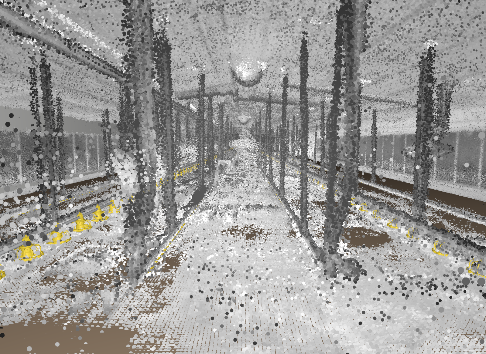
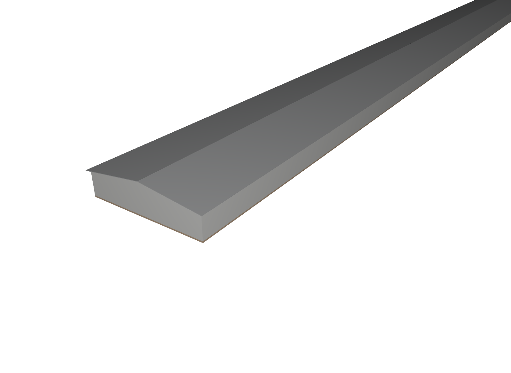
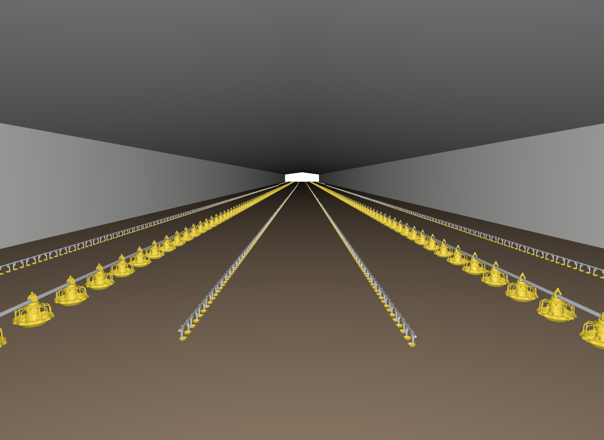
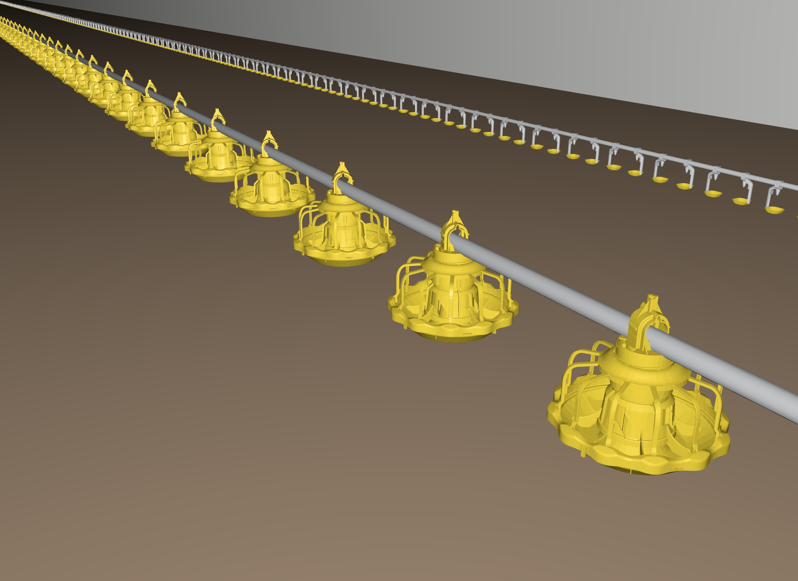
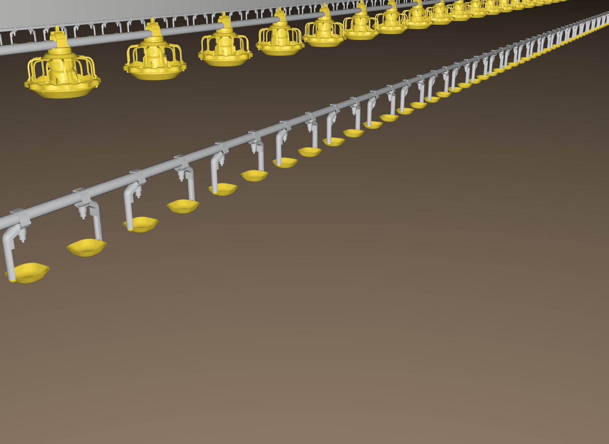
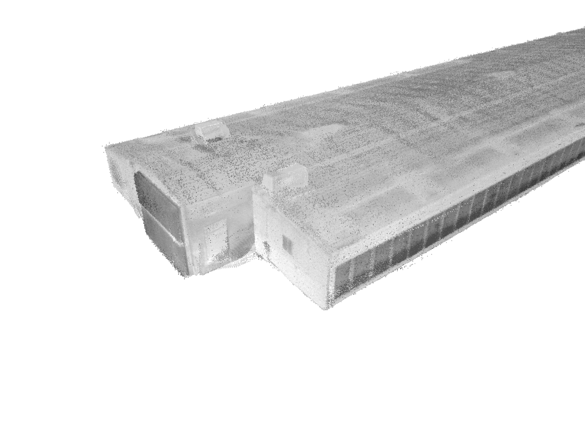
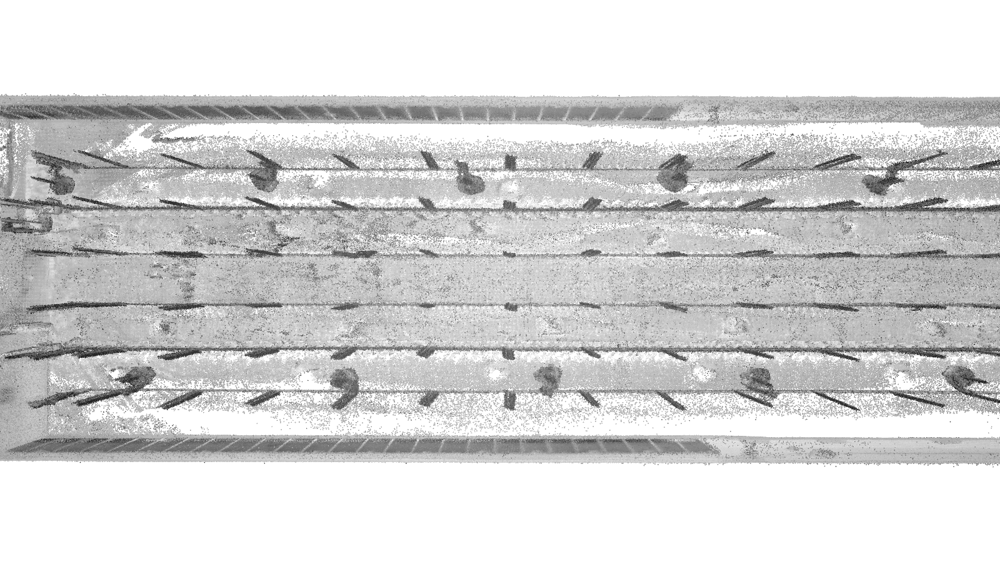
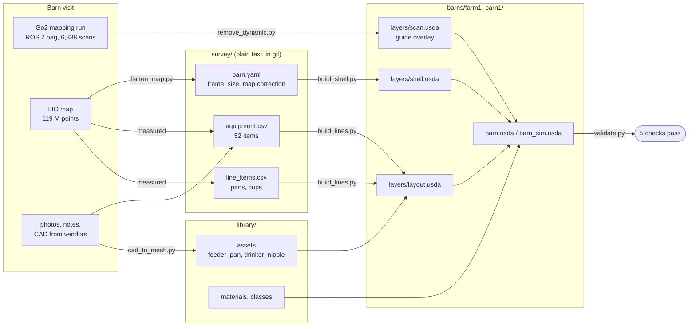
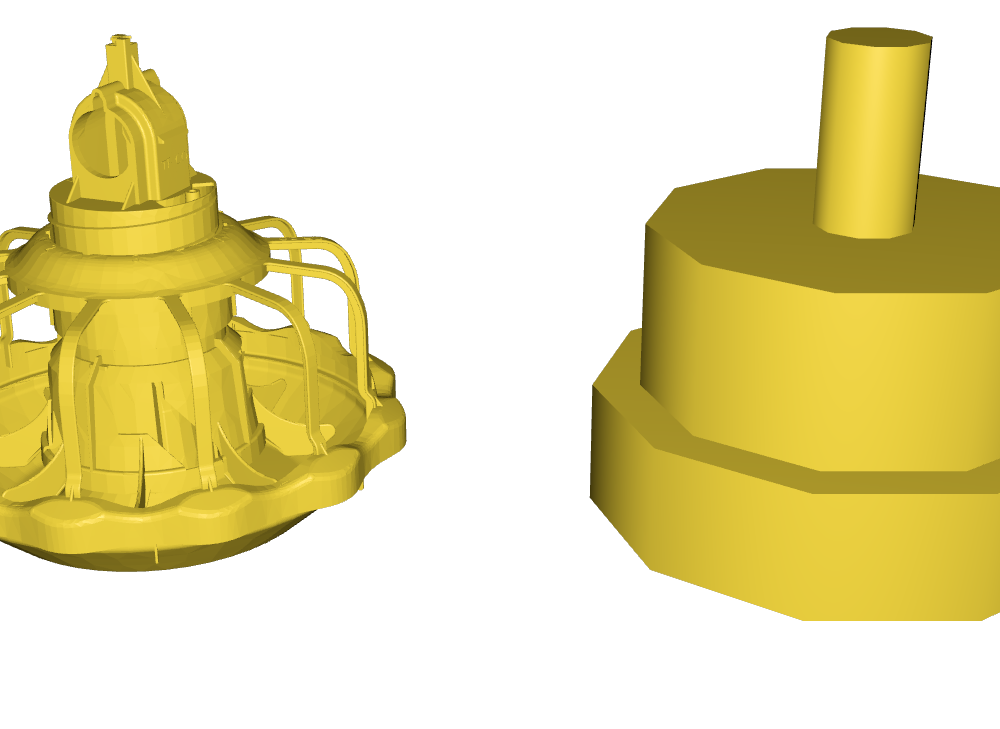
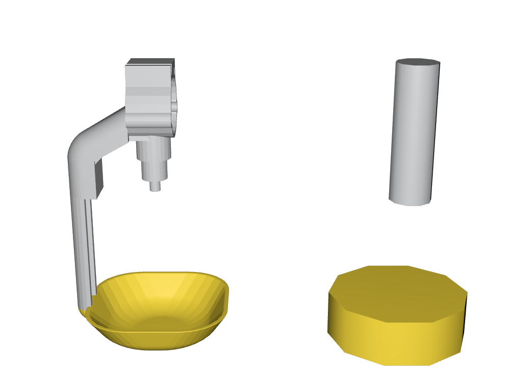

# go2-barn-twin

**A digital twin of a real 155 m commercial broiler barn, built in OpenUSD from a lidar survey, for training and testing a Unitree Go2 quadruped in NVIDIA Isaac Sim.**




*The twin from the robot's start position: library assets placed from the survey (yellow pans and drinker cups), over the cleaned lidar scan of the real barn.*

---

## What this is

A robot that works in a poultry barn has to be trained somewhere other than the barn. This repo builds that somewhere: a geometrically faithful, simulation-ready copy of one specific barn, assembled from the same data a robot collects on a mapping run.

- **Measured, not modelled by eye.** Every line, pan, heater and fan sits where a 119-million-point lidar map says it is.
- **One survey in, one barn out.** A barn is a folder of plain-text survey files (`barn.yaml`, `equipment.csv`, `line_items.csv`). The scripts rebuild the whole USD stage from them in about 35 seconds; nothing in a `.usda` is hand-placed.
- **Built to scale to the next barn.** Assets live in a shared library, and the next barn is a new survey folder. Barns run from this 155 m house up to 350 m, and none of the scripts assume a size.
- **Composed the USD way.** Sublayers, references, payloads, inherits, specializes, variants and instancing each do the job they are meant for (see [How the stage is composed](#how-the-stage-is-composed)).

## Gallery

| | |
|---|---|
|  **The shell**, generated from `barn.yaml`: 155.3 × 12.8 m, 2.65 m eaves, 3.5 m ridge |  **All eight lines**: 2 feeder lines (434 pans) and 8 drinker segments (3,867 cups) |
|  **Feeder pans** clamped to the feed tube every 0.686 m, as measured in the scan |  **Drinker cups** every 0.15 m, cup arms alternating along the pipe, as installed |
|  **The lidar map**: control room, roof and the cool-cell pads on the side wall |  **Cutaway of the scan** (everything above 2.4 m clipped): cool cells on both walls, 20 brooding heaters, eight lines |

## From a robot's mapping run to a USD stage



### Lidar pipeline highlights

| Step | Problem | What the script does | Result |
|---|---|---|---|
| `flatten_map.py` | The LIO map of a flat barn bends: the floor drops **2.6 m** over 155 m (pitch drift), and the robot started 1.6° off the walls. Remapping wasn't possible. | Finds the yaw from wall sharpness, fits the floor height along x on floor-only points, and unbends every point (height above the fitted floor becomes z; arc length becomes x). | Floor flat to **−2.2 / +2.6 cm**; ridge height constant at 3.45–3.52 m; end walls vertical to 1.3 cm |
| `remove_dynamic.py` | Two people walked with the robot (one held the brooding curtain up), leaving ghost trails and a ladder in the map. | Ray-casts all 6,338 scans from their poses on a 10 cm voxel grid. Voxels that later rays see through are dynamic, except inside the envelope of a surveyed static object (lines, bollards, heaters, walls), so thin tubes aren't eroded. | **2.1 %** of points removed; walkway ghosts −87 %; bollards, heaters and feed tubes untouched |
| `import_scan.py` | 119 M points are too many to view or to version. | 3 cm voxel downsample, 17 tiles of 10 m, each a `UsdGeom.Points` payload with intensity as a primvar and grey `displayColor`, all with purpose `guide`. | 15.4 M points that load tile by tile and never appear in final renders or synthetic training images |
| measured from the scan | Equipment layout and spacing. | Circle fits for bollards and heaters, autocorrelation for pan and cup spacing, height profiles for line heights. | Pans every **0.686 m** (217 per line), cups every **0.150 m**, per-segment line heights |

## The assets

| Feeder pan (full and proxy LOD) | Drinker nipple and drip cup (full and proxy LOD) |
|---|---|
|  |  |
| From the vendor's STEP file (8 solids, CATIA AP242) through FreeCAD, 110k triangles; pivot at the bottom of the pan | From the vendor's STL, split into cup and nipple; pivot at the bottom of the cup |

Every asset is a component folder written by `make_asset.py`:

```
library/assets/feeder_pan/
    feeder_pan.usda   interface: kind=component, assetInfo, lod variant (proxy | full), payload
    payload.usda      sublayers mtl.usda over geo.usda: one payload arc loads both
    geo.usda          /FeederPan/Geom/Full and /Geom/Proxy, metres, pivot at the origin
    mtl.usda          Looks that specialize the library's base materials, plus bindings
    phys.usda         convex-hull colliders, pulled in only by the sim layer
```

## How the stage is composed

The barn uses each LIVRPS composition arc for the job it is designed for:

| Arc | Used for | Where |
|---|---|---|
| **Sublayers** | who edits what: one layer per concern, strongest first | `barn.usda`: lighting · looks · dressing · layout · shell · scan · classes |
| **Inherits** | edit all of a kind at once: one `over "_class_FeederPan"` reaches all 434 pans | `library/classes.usda` (38 classes); every line, pan and nipple inherits one |
| **Variants** | pick one of several: `lod = proxy \| full` on every asset (later `state`, `season`) | asset interface files |
| **References** | reuse: every pan and nipple references its library asset | `layers/layout.usda` |
| **Payloads** | load later: asset geometry and the 17 scan tiles | asset interfaces, `layers/scan.usda` |
| **Specializes** | a fallback family: asset materials specialize `/_mat_Metal`, `/_mat_Plastic` … so a library change reaches every material that didn't override it | asset `mtl.usda`, `shell.usda` |
| **Instancing** | 4,301 placed items share **2 prototypes**; each stays a real prim the robot can target (`FeederLine_01/Pan_037`) | `instanceable = true` in `layout.usda` |

```
barn_sim.usda                     what Isaac Sim opens
├── layers/sim_overrides.usda     hand-edited: proxy LODs, hidden decor, scenarios
├── layers/physics.usda           PhysicsScene, colliders           (SIM-01)
├── layers/semantics.usda         UsdSemantics labels               (SIM-02)
└── barn.usda                     the render stage
    ├── layers/lighting.usda                                        (BARN-07)
    ├── layers/looks.usda                                           (BARN-08)
    ├── layers/dressing.usda                                        (BARN-06)
    ├── layers/layout.usda        lines, pans, nipples (rest of equipment.csv: BARN-03)
    ├── layers/shell.usda         floor, walls, gables, roof
    ├── layers/scan.usda          lidar overlay, purpose = guide
    └── ../../library/classes.usda
```

### Conventions

Isaac Sim and ROS are the targets, so: **Z-up and metres on every layer**, a `defaultPrim` in every file, `/World` as the root, PascalCase prims with zero-padded copies (`DrinkerLine_03`, `Nipple_042`), custom attributes namespaced `barn:` (`barn:id`, `barn:assetType`), relative asset paths only, and nothing below the floor except the floor slab. `validate.py` enforces these on the composed stage; `test_validate.py` proves it catches each violation.

**The barn frame:** the origin is the spot where the robot started mapping, on the floor; x runs down the barn parallel to the long walls, y to the left, z up. The lidar map and the twin share it, so a robot pose in the map is a pose in the twin (after the same `BarnFrame` correction).

## Repository layout

```
go2-barn-twin/
├── barn_usd/                         the twin
│   ├── library/                      shared by every barn
│   │   ├── assets/<name>/            component assets (+ source/ CAD from vendors)
│   │   ├── materials/library.usda    base UsdPreviewSurface materials (/_mat_*)
│   │   ├── classes.usda              /_class_* prims for inherits
│   │   └── equipment_types.csv       asset types, ID prefixes, states
│   ├── barns/
│   │   ├── _template/survey/         field kit: checklist + empty equipment.csv
│   │   └── farm1_barn1/              one real barn
│   │       ├── barn.usda             render entry
│   │       ├── barn_sim.usda         Isaac Sim entry
│   │       ├── layers/               generated layers (+ scan.usda overlay)
│   │       ├── survey/               barn.yaml, equipment.csv, line_items.csv, visit checklists
│   │       │   └── map/, photos/     raw data (git-ignored: 10+ GB)
│   │       └── renders/              cameras.usda + the images in this README
│   ├── scripts/                      every generator, the validator and the lidar tools
│   └── scratch/                      experiments
├── infra/                            AWS GPU workstation for Isaac Sim (see infra/README.md)
└── docs/                             README images and the cameras that make them
```

## Quick start

**Requirements:** OpenUSD 25.08 built from source into `~/openusd_built` (`bash infra/build_openusd.sh`, about 1–2 h), Python 3.8 venv with `numpy laspy pyyaml mcap mcap-ros2-support`, and FreeCAD (`freecadcmd`) only for converting STEP files.

```bash
source .venv/bin/activate          # puts usdview, usdrecord and pxr on the path
cd barn_usd

# library (once, or when an asset changes)
python scripts/build_materials.py
python scripts/build_classes.py
python scripts/build_feeder_pan.py
python scripts/build_drinker_nipple.py

# one barn: shell + layout + empty layers + entry files, then validation (~35 s)
python scripts/build_barn.py barns/farm1_barn1

# look at it
usdview barns/farm1_barn1/barn.usda                  # View > Display Purposes > Guide shows the scan
usdview barns/farm1_barn1/renders/cameras.usda       # the README views, under the Camera menu
```

<details>
<summary><b>Rebuilding from the raw lidar data</b> (needs <code>survey/map/</code>, not in git)</summary>

```bash
# 1. straighten the drifted LIO map into the barn frame, write the numbers for barn.yaml
python scripts/flatten_map.py barns/farm1_barn1 barn1full_map_consistent.pcd

# 2. ray-cast the raw bag to drop people (~45 min; --reuse-grid re-runs only the filter)
python scripts/remove_dynamic.py barns/farm1_barn1 barn1full-1970-01-02-00-25-28 \
    barn1full_map_consistent_flatten_report.json

# 3. tile the clean cloud into USD payloads
python scripts/import_scan.py barns/farm1_barn1 barn1full-1970-01-02-00-25-28_barn_clean.las
```
</details>

<details>
<summary><b>Converting a vendor CAD file into an asset</b></summary>

```bash
freecadcmd scripts/cad_to_mesh.py -- "library/assets/feeder_pan/source/broiler-pan-1/TF-Broiler Pan1_AllCATPart.stp" \
    library/assets/feeder_pan/source/feeder_pan_mesh.npz 0.5
python scripts/build_feeder_pan.py     # mm -> m, pivot, part looks, proxy LOD, colliders
```
</details>

## Cloud workstation

Isaac Sim needs an RTX GPU, so it runs headless on an AWS `g6.2xlarge` (NVIDIA L4) and streams to the laptop over WebRTC inside a private Tailscale network. No simulator port is ever public, every script checks the AWS account before acting, and a data volume keeps Docker images and shader caches across rebuilds. See [`infra/README.md`](infra/README.md).

## Status

| Track | Done | Next |
|---|---|---|
| **Survey** | first visit; barn frame; map flattened; walkers removed; 52 items placed from the map | second visit with [`visit_02.md`](barn_usd/barns/farm1_barn1/survey/visit_02.md): doors, lights, sensors, wall thickness |
| **Library** | materials, classes, asset generator, feeder pan, drinker nipple | heater, tunnel fan, cool cell, fence, curtain, bollard, hopper |
| **Barn** | entry files and layer stack, shell, lines with all pans and cups, validator | rest of `equipment.csv` in layout, floor mesh from the lidar, lighting |
| **Sim** | GPU workstation | physics and semantics layers, open `barn_sim.usda` in Isaac Sim, simulated vs real lidar |

## License

[Apache 2.0](LICENSE).
